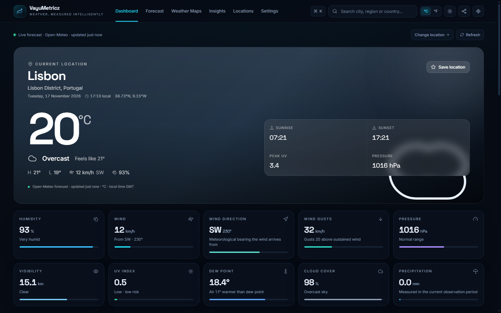
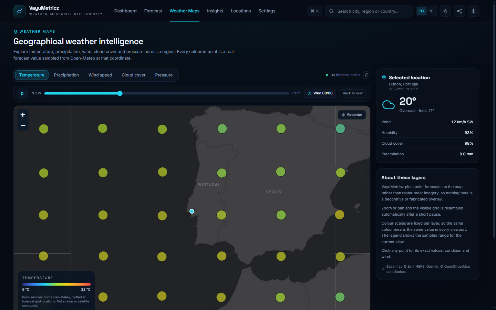
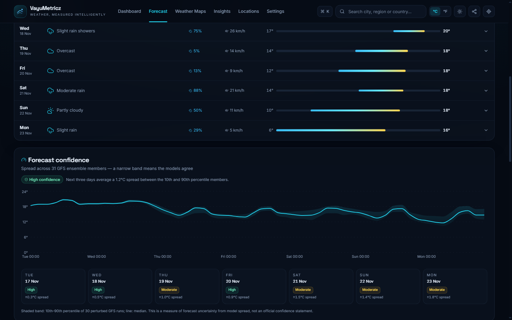
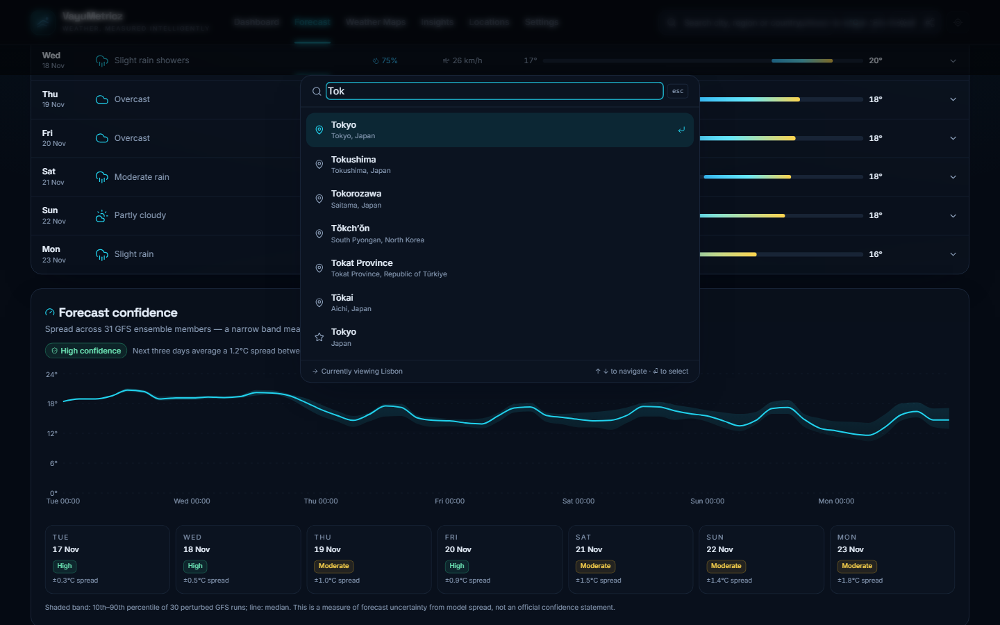

# VayuMetricz

**Weather, measured intelligently.**

VayuMetricz is a global weather intelligence and forecasting platform. It combines real-time conditions, hourly and seven-day forecasts, atmospheric analytics, an interactive weather map, air quality and a transparent rule-based insight engine — all built on open meteorological data with no API keys and no paid services.

Built with React, TypeScript, Vite, Tailwind CSS, Recharts, Leaflet and the Open-Meteo APIs.

**Live application:** [vayumetricz-7b57c7.freebuff.page](https://vayumetricz-7b57c7.freebuff.page)

---

## Overview

VayuMetricz is designed as a premium weather product rather than a demo: a dark-first atmospheric design system, real measurements in every card, honest empty and error states, and no fabricated data anywhere. Every number on screen comes from an Open-Meteo response, and every chart is generated from the same payload the rest of the interface uses.

The application is a static single-page app. There is no backend to deploy, no database and no server-side secrets: weather, geocoding and air-quality requests are made directly to public Open-Meteo endpoints. User preferences and saved locations are stored in the browser only.

## Main features

- **Dashboard** — weather-dependent hero with live local clock, current temperature, feels-like, daily high/low, sunrise/sunset and ten atmospheric measurement cards (humidity, wind speed, wind direction, gusts, pressure, visibility, UV, dew point, cloud cover, precipitation).
- **Hourly forecast** — the next 24 hours (48 on the Forecast page) with condition icons, temperature, precipitation probability, wind, a temperature trend chart, and a detail panel for any selected hour.
- **Seven-day forecast** — daily conditions, precipitation probability, wind, temperature-range bars against the whole week, and an expandable per-day table of hourly temperature, rain, humidity and wind.
- **Analytics** — temperature vs. feels-like, precipitation probability and accumulation on separate axes, wind speed and gusts, wind direction, humidity, MSL pressure and UV index, each with tooltips and a 24 h / 48 h / 7-day range switch.
- **Insight engine** — thirteen transparent rules (peak temperature, rain window, rain total, wind trend, gust peak, humidity rise, dew-point comfort, pressure trend, UV exposure, visibility, air quality, tomorrow's summary) that quote the measurement that triggered them.
- **Weather map** — Leaflet map with temperature, precipitation, wind, cloud and pressure layers, rendered from genuine Open-Meteo point samples across the current viewport, with fixed colour scales, a live legend and clickable point detail.
- **Map timeline** — a play/pause scrubber steps through the next 24 hours of the location's own local hours, re-sampling the visible grid for each frame, so you can watch a front move instead of seeing a single snapshot.
- **Forecast confidence** — the 10th–90th percentile band across 31 GFS ensemble members (30 perturbed runs plus control), with a median line and a per-day confidence rating derived from the actual spread. Narrow band means the models agree; wide band means the forecast could still change.
- **Command palette** — ⌘K / Ctrl-K (or `/`) opens a single search box for every city on Earth plus in-app pages, fully keyboard-navigable with arrow keys and Enter.
- **Shareable links** — the address bar always carries the current coordinates and label, so any forecast can be copied (and there is a one-click share button) and re-opened exactly by someone else.
- **Air quality** — CAMS European AQI and US AQI, PM2.5, PM10, O₃, NO₂, CO and SO₂, plus a modelled hourly AQI trend, with the two AQI standards explained.
- **Locations** — worldwide geocoding search with keyboard navigation and suggestions, saved favourites (up to eight), browser geolocation with graceful denial handling, and a side-by-side comparison of up to four locations.
- **Settings** — Celsius/Fahrenheit, four wind units, dark/light appearance, 12/24-hour clock, saved-location management and a data/privacy summary. Everything persists locally.
- **Quality details** — skeleton loaders, retryable error states, "unavailable" states for missing measurements, a stale-data warning, reduced-motion support, a skip-to-content link, keyboard-accessible controls, route-level code splitting and vendor chunk splitting (the chart and map bundles only load on the pages that need them).

## Screenshots

Captured from the live application in the dark theme (New Delhi, desktop 1440×900).

### Dashboard — current conditions and measurements



The hero reports the location, local clock, temperature, feels-like, daily high/low, condition and sun times. Below it, ten measurement cards carry humidity, wind speed and direction, gusts, pressure, visibility, UV, dew point, cloud cover and precipitation — every value read directly from Open-Meteo.

### Weather map — temperature layer with legend and point detail



The map plots genuine Open-Meteo values sampled across the visible area — not a decorative overlay — with a fixed colour scale per layer, a legend showing the sampled range, a detail panel for the selected point and a timeline scrubber that re-samples the grid for any of the next 24 local hours.

### Forecast confidence — 31-member ensemble spread



The shaded band is the 10th–90th percentile of 31 GFS ensemble members; the line is the median. Each day gets a confidence rating computed from the mean spread, so “high confidence” is an observed agreement between models rather than an opinion.

### Command palette — ⌘K search for cities and pages



One search box for every city on Earth plus every page in the app, with arrow-key navigation, saved-location shortcuts and a Ctrl-K toggle.

More captures (hourly strip, analytics, locations comparison, mobile layout) can be added to `docs/screenshots/` from your own local run.

## Technology stack

| Concern | Choice |
| --- | --- |
| Framework | React 18 + TypeScript |
| Build tool | Vite 6 |
| Styling | Tailwind CSS 3 with CSS-variable design tokens |
| Charts | Recharts |
| Maps | Leaflet + React Leaflet (Esri canvas basemaps) |
| Icons | Lucide |
| Routing | React Router 6 |
| Data | Open-Meteo Forecast, Geocoding, Air Quality and Ensemble APIs |

## API information

No API keys are required. All endpoints are public and free for non-commercial use with attribution.

| Purpose | Endpoint |
| --- | --- |
| Forecast (current, hourly, daily) | `https://api.open-meteo.com/v1/forecast` |
| Location search | `https://geocoding-api.open-meteo.com/v1/search` |
| Air quality | `https://air-quality-api.open-meteo.com/v1/air-quality` |
| Ensemble (forecast confidence) | `https://ensemble-api.open-meteo.com/v1/ensemble` |
| Base map tiles | Esri `World_Dark_Gray_Base` / `World_Light_Gray_Base` canvas tiles (no key required) |

Measurements are always requested in metric units (celsius, km/h, mm, hPa) and converted for display, so changing units never triggers another request. Forecast responses are cached in memory for 10 minutes, air quality for 20 minutes and geocoding for 24 hours.

## Architecture overview

```
src/
  components/
    charts/        TrendChart (shared chart shell) and analytics grid
    common/        Card, segmented control, skeletons, states, section header
    insights/      Insight cards with category filtering
    locations/     Multi-location comparison
    maps/          Leaflet map with sampled forecast layers
    navigation/    Responsive navigation and location search
    weather/       Hero, metric grid, hourly, daily, sun path, air quality, alerts
  context/         AppContext — settings, place, saved locations, data fetching
  pages/           Dashboard, Forecast, WeatherMaps, Insights, Locations, Settings
  services/        weatherApi, geocodingApi, airQualityApi, cached HTTP client
  types/           Shared weather and settings types
  utils/           units, time (timezone-safe), WMO codes, insight rules
```

Principles:

- **Services never render.** API modules return normalised objects; components only format.
- **One fetch per location.** `AppContext` owns the forecast and air-quality lifecycle, including abort-free request sequencing, 10-minute background refresh and manual force refresh.
- **Display-time conversion.** Charts, cards and text all read the same unit helpers, so a unit switch cannot desynchronise the interface.
- **Timezone honesty.** Open-Meteo returns local wall-clock timestamps; they are parsed as wall clock and formatted in UTC so a location's local time is never shifted by the viewer's timezone.
- **Transparent inference.** The insight engine is a set of documented thresholds over provider data, not a generative model.

## Installation

Requirements: Node.js 18 or newer and npm.

```bash
git clone https://github.com/<your-account>/vayumetricz.git
cd vayumetricz
npm install
```

## Environment configuration

None required. There are no API keys, secrets or environment variables — the Open-Meteo endpoints used here are public. If you later add a provider that needs a key, keep it in a `.env` file (already git-ignored) prefixed with `VITE_` only for public values, and never commit it.

## Local development

```bash
npm run dev      # http://localhost:3000
npm run build    # type-check then production build into dist/
npm run preview  # serve the production build
npm run typecheck
```

## Deployment

The build is fully static, so any static host works.

**Vercel / Netlify** — build command `npm run build`, output directory `dist`. Because routing is client-side, add a SPA fallback:

- Netlify: `/* /index.html 200` in `public/_redirects`.
- Vercel: a rewrite of all paths to `/index.html`.
- GitHub Pages: publish `dist/` and add a `404.html` copy of `index.html`.

**Cloudflare Pages** — framework preset Vite, build command `npm run build`, output `dist`.

## API attribution

- Weather, geocoding and air-quality data: [Open-Meteo](https://open-meteo.com/) — CC BY 4.0. Air quality data derives from the Copernicus Atmosphere Monitoring Service (CAMS).
- Base map tiles: © [Esri](https://www.esri.com/) — Esri, HERE, Garmin, © [OpenStreetMap](https://www.openstreetmap.org/copyright) contributors.

Attribution is displayed in the dashboard footer, the map control and the Settings page.

## Known limitations

- **No official weather alerts.** Open-Meteo does not provide national warning feeds, so VayuMetricz does not display official alerts. The alerts panel says so explicitly and shows clearly-labelled forecast highlights (thunderstorm, heavy rain, strong gusts, low visibility) derived from the forecast instead.
- **The map is point-sampled, not radar.** Layers are coloured forecast points at grid locations, not satellite or radar imagery. A raster weather-tile provider would need an additional service and key.
- **Reverse geocoding is not offered by Open-Meteo.** A geolocated position is labelled "Current location" with its coordinates; use search to name it.
- **Air quality coverage varies.** Remote ocean and some regions have no CAMS analysis and return no values, which the interface reports honestly.
- **Solar noon is approximated** as the midpoint of daylight from the provider's sunrise and sunset times.
- **Screenshots are not included** in this repository yet; capture them from a local run as described above.
- Forecasts are model output. They are not observations and must not be treated as official warnings.

## Roadmap

- Official alert ingestion via a national meteorological authority or meteoalarm-compatible feed.
- Raster weather tile layers (temperature, precipitation, cloud) with an optional provider key.
- Historical archive charts from the Open-Meteo archive API for month-to-date trends.
- Saved-location ordering and drag-to-reorder.
- Optional PWA install and offline shell with last-known forecast.
- Automated accessibility and visual-regression checks in CI.

## License

Source code released under the MIT License. Weather data remains subject to Open-Meteo's CC BY 4.0 terms; map tiles remain subject to OpenStreetMap and CARTO attribution requirements.

---

VayuMetricz — **Weather, measured intelligently.**
